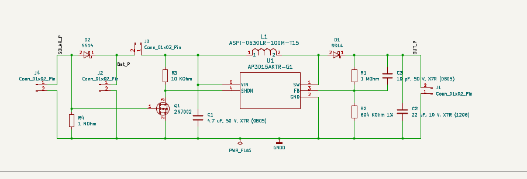
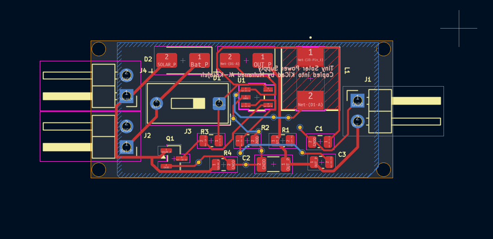
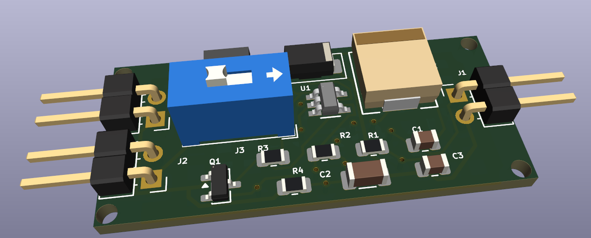
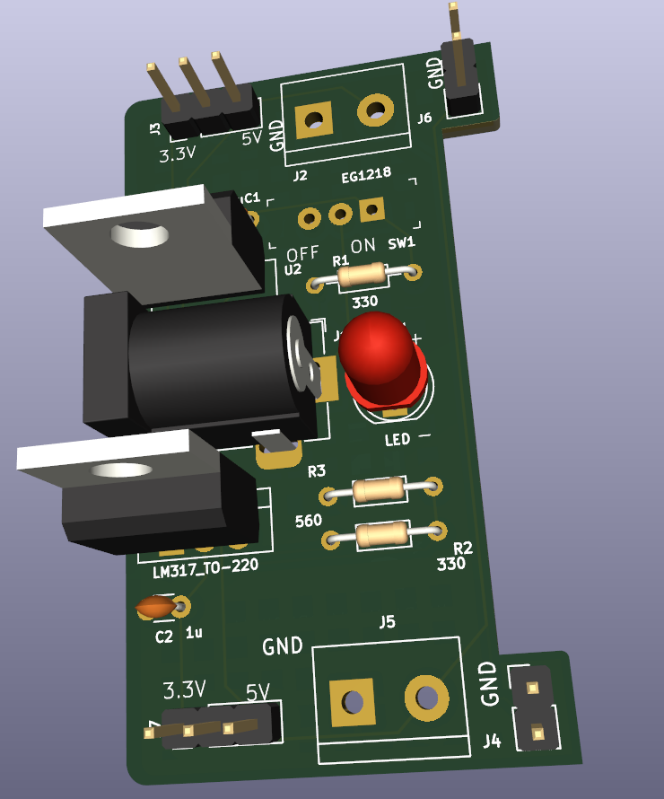
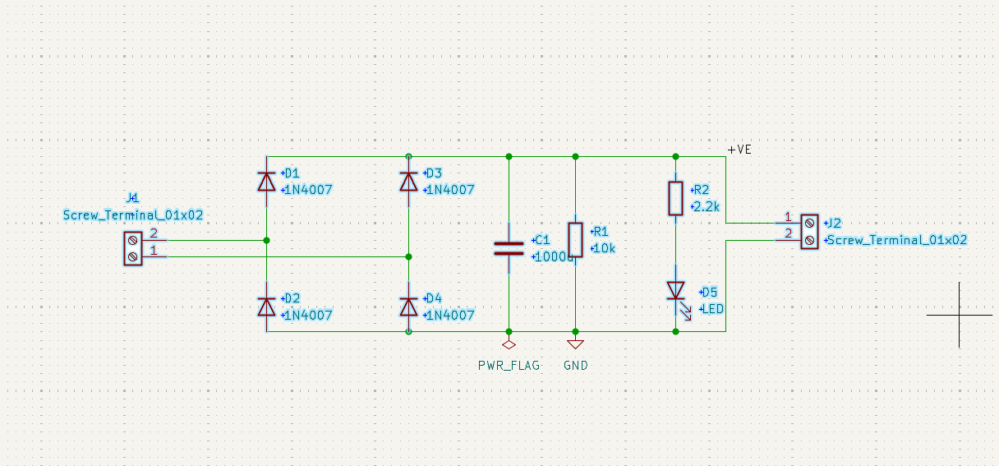
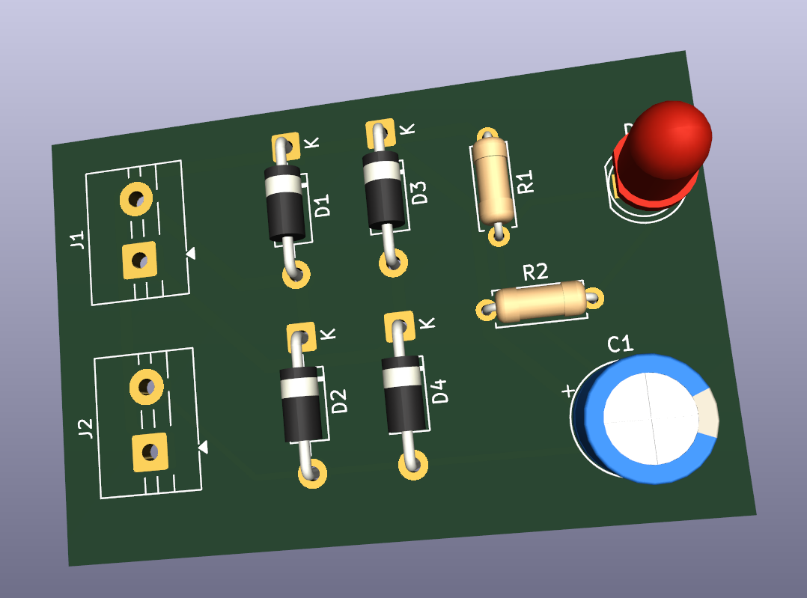
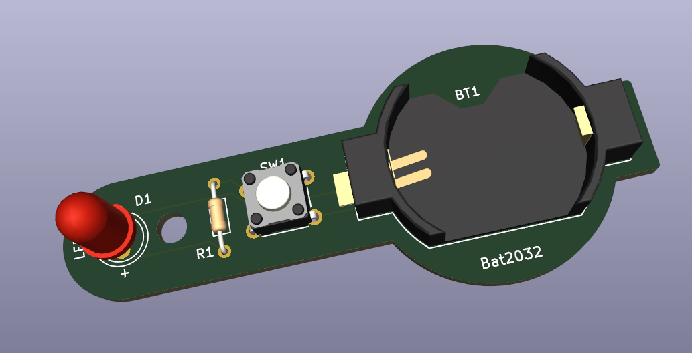

# KiCad Learning Projects

Practice boards I recreated in KiCad while learning schematic capture, footprints, PCB layout and fabrication output. **These are learning projects: the designs were reproduced from public tutorials and open designs, not original work.** The goal was to practise the workflow and to understand each circuit, not to claim the designs.

## Projects

### Tiny solar supply (`tiny-solar-supply`)
Solar-powered 3.3 V boost converter built around the AP3015 (output set by the 1 MΩ / 604 kΩ feedback divider), with a 2N7002 switch, SS14 Schottky diodes and SMD parts. I reviewed the layout and noted improvements for a Rev B (switching loop, feedback routing, ground plane, output switch-off).

### Breadboard power supply (`breadboard-power-supply`)
LM317 adjustable supply with 3.3 V / 5 V header outputs, power LED, slide switch and screw terminals. Includes Gerber files.

### Bridge rectifier (`bridge-rectifier`)
Four 1N4007 diodes, a 1000 µF smoothing capacitor and a 10 kΩ bleeder resistor and an LED indicator (2.2 kΩ) on a through-hole board with screw terminals.

### LED torch (`led-torch`)
CR2032 coin-cell LED light with push button and series resistor. Includes Gerber files.

### Work in progress
- `arduino-nano-board`: custom Arduino Nano footprint practice (no complete board yet).
- `mcu-datalogger`: early project files for an MCU data logger (not finished).

## Notes
- Made with KiCad 9. Open the `.kicad_pro` file in each folder.
- Custom symbol and footprint libraries were downloaded separately and are not included, so KiCad may report missing libraries on first open.
- Source links for the original designs: _to be added per project_.

## Author
Mohanad Al-Karajeh, Systems Engineering student, Graz.